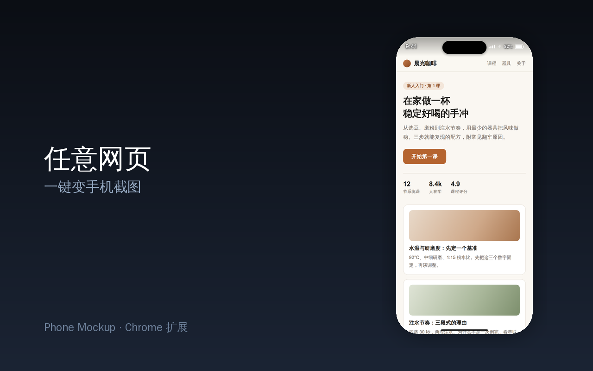

# 手机截图模拟器 · Phone Mockup

把任意网页变成手机截图。状态栏上的每一项都能改，一键截图自动加圆角阴影。

不需要联网，不上传数据，代码全部在本地跑。



## 功能

- **状态栏全可改**：时间、运营商、5G/4G/LTE、信号格数、WiFi、电量、充电状态
- **按真机规格绘制**：iOS 状态栏 54pt / 灵动岛 126×37pt / 时间 17pt；Android 24dp / 时间 14sp
- **三种屏幕顶部**：灵动岛 / 刘海 / 挖孔
- **底部导航**：iOS 横条 / 安卓三键
- **6 个机型预设**：iPhone 15、iPhone 14、iPhone SE、三星 S24、小米 14、通用
- **截图美化**：自动加 6% 外距、圆角、投影和深色渐变背景
- **智能细节**：连 WiFi 时自动隐藏 5G 制式（真机行为），电量低于 20% 变红，充电时变绿带闪电

## 安装

**方式一：下载 zip（推荐，30 秒）**

1. 到 [Releases](../../releases) 下载 `phone-mockup.zip`
2. 解压到任意文件夹
3. Chrome 地址栏输入 `chrome://extensions`
4. 右上角打开「开发者模式」
5. 点「加载已解压的扩展程序」，选择解压出来的文件夹

**方式二：从源码加载**

```bash
git clone https://github.com/cointaboo/phone-mockup.git
```

同样在 `chrome://extensions` 里「加载已解压的扩展程序」，选克隆下来的仓库根目录（能看到 `manifest.json` 那一层）。

改完代码在扩展卡片上点刷新按钮即可，不用重装。

> 需要 `host_permissions: <all_urls>`，因为要往任意页面注入外壳。安装时 Chrome 会提示「读取和更改您在所有网站上的数据」，这是注入功能的必要条件。

## 用法

1. 打开任意网页
2. 点工具栏的手机图标
3. 选机型预设，或手动调参数
4. 点「应用」→ 页面出现手机外壳
5. 点「截图」→ 保存到下载目录

### 手机视图（推荐打开）

popup 里的「手机视图」开关会用浏览器调试协议把页面真的改成手机宽度（390 / 393 / 412 / 430 / 360 可选），
网站的响应式布局会生效，状态栏落在留白区而不是压住导航栏。

打开时 Chrome 顶部会显示「正在调试此浏览器」横幅，关掉开关就恢复桌面布局。

不用手机视图也可以：按 F12 → 切换设备工具栏，手动选 iPhone 宽度。

## 机型预设

| 预设 | 特征 |
|---|---|
| iPhone 15 | 灵动岛 · 5G · 82% · iOS 横条 |
| iPhone 14 | 刘海 · 3 格信号 · 46% |
| iPhone SE | 无刘海 · 4G · 64% · 无 WiFi |
| 三星 S24 | 挖孔 · 安卓三键 · 91% |
| 小米 14 | 挖孔 · 安卓三键 · 73% |
| 通用 | 只有状态栏，无外壳无压暗 |

## 参数

| 参数 | 取值范围 | 说明 |
|---|---|---|
| 时间 | 任意 / 留空 | 留空跟随系统实时时间；填 `9:41` 固定 |
| 运营商 | 任意文字 | 中国移动 / 联通 / 电信 等 |
| 网络 | 5G / 4G / LTE / 隐藏 | 连 WiFi 时自动隐藏 |
| 信号 | 0–4 格 | 0 = 不显示 |
| 电量 | 0–100% | ≤20% 变红，充电时变绿+闪电 |
| 显示百分比 | 开 / 关 | 关掉只有电池图标（iOS 风格） |
| 屏幕顶部 | 灵动岛 / 刘海 / 挖孔 / 无 | |
| 底部导航 | iOS 横条 / 安卓三键 | |
| 状态栏系统 | iOS / Android | 决定尺寸规范 |
| 状态栏文字 | 白 / 黑 | 深色页面用白，浅色页面用黑 |
| 渐变底 | 开 / 关 | 浅色页面上保证白字可读 |
| 圆角遮罩 | 开 / 关 | 模拟手机屏幕圆角 |
| 外围压暗 | 开 / 关 | 四角压暗 55% |
| 截图美化 | 开 / 关 | 加外距、圆角、投影 |

## 尺寸依据

状态栏不是随手写的，按实测规格：

```
iOS（iPhone 15 / 16 等灵动岛机型）
  状态栏高度      54 pt
  顶部安全区      59 pt（16 Pro / 17 为 62 pt）
  灵动岛          126 × 37 pt，距顶 11 pt
  时间字号        17 pt（semibold）
  左右内边距      27 pt
  电池            24.3 × 11.3 pt
  WiFi            15.6 × 11.6 pt

Android（Material 规范）
  状态栏高度      24 dp
  时间字号        14 sp
```

数据来源：Xcode Simulator 实测 + Android Material Design 规范。

## 技术实现

- **Manifest V3**，动态注入（`chrome.scripting.executeScript`），不常驻、不占内存
- **覆盖层**叠加在 `document.documentElement` 上，`pointer-events: none` 不挡点击
- **不用 iframe**：绝大多数站点带 `X-Frame-Options` 或 CSP `frame-ancestors`，iframe 套不进去
- **注入幂等**：重复执行只更新参数，不会叠多层
- **状态栏文字多层描边**：白字压白底也能看清
- 截图美化在 popup 里用 canvas 处理（外距 + 圆角 + 阴影 + 渐变背景）

## 权限

```json
"permissions": ["scripting", "storage", "downloads"],
"host_permissions": ["<all_urls>"]
```

| 权限 | 用途 |
|---|---|
| `scripting` | 向页面注入外壳视觉层 |
| `storage` | 保存参数设置在本机 |
| `downloads` | 保存截图 |
| `<all_urls>` | 允许对任意网站注入（功能必需） |

**不联网、不上传、不收集任何数据。**

## 已知限制

- `chrome://`、扩展商店等内部页面无法注入（Chrome 限制）
- 桌面宽页面上套壳会与网站顶部导航重叠（覆盖层不改页面布局）
- 截图只截当前可见区域，长页面需分段

## License

MIT

---

**原文与完整指南**：https://yuantou.one/guide/
